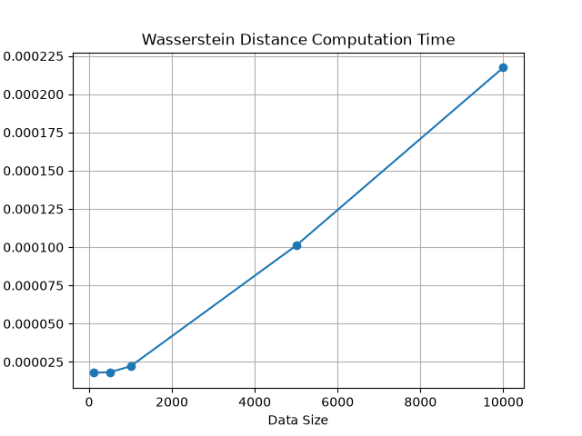
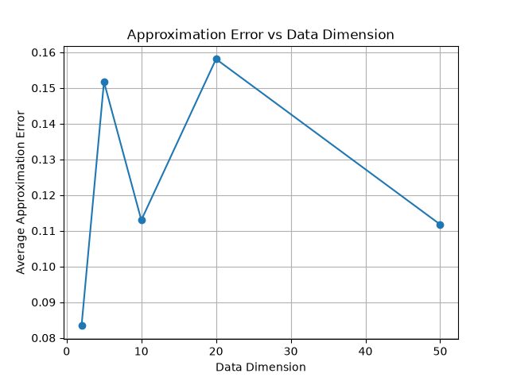
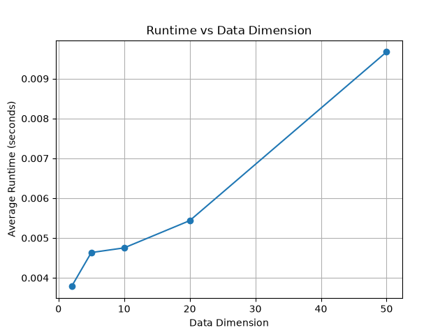

# Efficient Approximation of Wasserstein Distance for Large-Scale Data

## Overview

This project experimentally investigates how Wasserstein distance can be approximated while studying the trade-off between computational efficiency and approximation accuracy.

The experiments focus on two factors that can affect computational cost:

* Dataset size
* Data dimensionality

The project also explores subsampling and random-projection-based sliced Wasserstein distance as approximation approaches.

---

## Research Question

**How does the accuracy–efficiency trade-off of Wasserstein distance approximations change as dataset size and dimensionality increase?**

---

## Objectives

* Implement a basic 1D Wasserstein distance calculation.
* Study how computation time changes with dataset size.
* Investigate subsampling as an approximation strategy.
* Measure approximation error for different sample sizes.
* Study the effect of increasing data dimensionality.
* Explore sliced Wasserstein distance using random projections.
* Compare approximation accuracy and computational cost.

---

## Methodology

### 1. 1D Wasserstein Distance

For two equally sized one-dimensional samples, the samples are sorted and the mean absolute difference between corresponding sorted values is calculated.

This provides the baseline Wasserstein distance used in the experiments.

### 2. Dataset Size Experiment

The baseline calculation was tested with different dataset sizes:

* 100
* 500
* 1,000
* 5,000
* 10,000

Each size was evaluated over multiple trials to obtain average computation time.

### 3. Subsampling Approximation

A dataset containing 10,000 samples was used as the full-data reference.

Different subsample sizes were tested:

* 100
* 500
* 1,000
* 2,000
* 5,000
* 10,000

The approximation error was calculated as:

`Approximation Error = |Reference Distance - Approximate Distance|`

### 4. Higher-Dimensional Approximation

Higher-dimensional Gaussian datasets were generated with:

* 2 dimensions
* 5 dimensions
* 10 dimensions
* 20 dimensions
* 50 dimensions

Sliced Wasserstein distance was estimated using random projections.

The experiment compared an approximation using **50 projections** with a higher-projection **500-projection reference estimate**.

The 500-projection value is an empirical reference and is not treated as the exact high-dimensional Wasserstein distance.

---

## Results

### Dataset Size

The baseline experiments showed that computation time generally increased as the dataset size increased.

The calculated Wasserstein distance remained close to the expected separation between the two distributions.



---

### Subsampling

The subsampling experiment showed that approximation error generally decreased as the number of sampled points increased.

However, subsampling did not always result in lower runtime because random sampling itself introduces computational overhead.

This demonstrates that an approximation method can improve computational efficiency in principle while still requiring careful implementation and evaluation.

---

### Dimensionality

The higher-dimensional experiment produced the following results:

| Dimension | Average Error | Average Runtime (seconds) |
| --------: | ------------: | ------------------------: |
|         2 |        0.0834 |                   0.00379 |
|         5 |        0.1517 |                   0.00464 |
|        10 |        0.1130 |                   0.00475 |
|        20 |        0.1581 |                   0.00544 |
|        50 |        0.1118 |                   0.00967 |

The results show that computational cost generally increased with dimensionality.

Approximation error did not increase monotonically with dimension, indicating that the relationship between dimensionality and approximation accuracy is more complex.





---

## Key Findings

1. Wasserstein distance computation becomes more computationally expensive as dataset size increases.
2. Increasing the subsample size generally improves approximation accuracy.
3. Subsampling does not automatically reduce runtime because sampling introduces additional overhead.
4. Higher-dimensional sliced Wasserstein computation generally requires more computation.
5. Approximation error can vary across dimensions rather than increasing monotonically.
6. The number of random projections provides an accuracy–efficiency trade-off.

---

## Limitations

* The baseline Wasserstein implementation is limited to one-dimensional equally sized samples.
* The high-dimensional experiment uses sliced Wasserstein distance rather than exact general high-dimensional Wasserstein distance.
* The 500-projection calculation is used as an empirical reference rather than an exact ground truth.
* The experiments use synthetic Gaussian datasets.
* Runtime measurements depend on the hardware and software environment.

---

## Technologies

* Python
* NumPy
* Matplotlib
* CSV
* Git / GitHub

---

## Project Structure

```text
optimal_transport_project/
│
├── data/
│
├── src/
│   ├── generate_data.py
│   ├── exact_wasserstein.py
│   ├── approximation.py
│   ├── experiments.py
│   └── plot_results.py
│
├── results/
│   ├── figures/
│   │   ├── runtime_vs_size.png
│   │   ├── error_vs_dimension.png
│   │   └── runtime_vs_dimension.png
│   │
│   └── tables/
│       ├── baseline_results.csv
│       ├── approximation_results.csv
│       └── dimensionality_results.csv
│
├── report/
│
├── README.md
└── .gitignore
```

---

## How to Run

Install the required Python packages:

```bash
python -m pip install numpy matplotlib
```

Generate the initial distributions:

```bash
python src/generate_data.py
```

Calculate the baseline Wasserstein distance:

```bash
python src/exact_wasserstein.py
```

Run the dataset-size experiment:

```bash
python src/experiments.py
```

Run the approximation and dimensionality experiments:

```bash
python src/approximation.py
```

Generate the baseline runtime graph:

```bash
python src/plot_results.py
```

---

## Future Work

Possible extensions include:

* Testing larger datasets.
* Evaluating additional approximation strategies.
* Comparing different numbers of random projections.
* Testing real-world datasets.
* Comparing sliced Wasserstein distance with other optimal transport approximations.
* Investigating more computationally efficient implementations.

---

## Project Status

**Completed — Experimental Research Project**

This project was developed as an independent exploration of optimal transport and approximation methods, with a focus on understanding the relationship between accuracy, dataset size, dimensionality, and computational cost.
